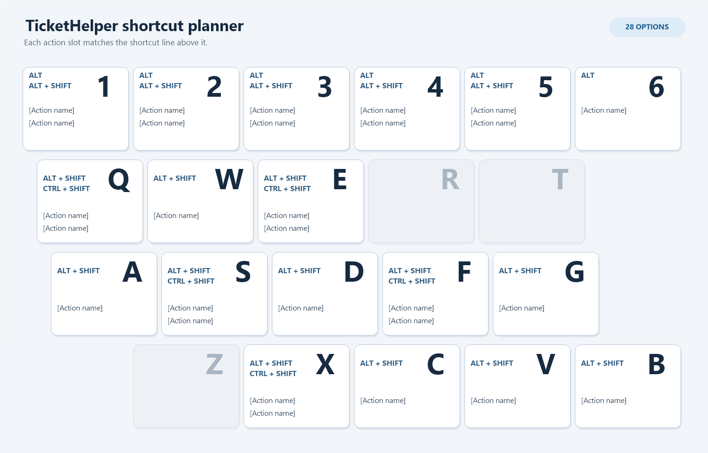

# Shortcut Planning (Chrome on Windows)

The keyboard image reserves three fixed modifier lines and three corresponding action lines per key. `[Action name]` is a placeholder, not a suggested or assigned command; unavailable combinations leave both matching lines blank. Keys with no available combination are dimmed.

This table records the owner's current recommendations. The options page shows them only when that exact combination is not assigned. It does not assign keys in `project/manifest.json` or in Chrome. Existing Chrome assignments stay in place when command IDs do; a reordered action whose internal command ID changed needs reassignment. `—` in **Suggested Action** means no recommendation yet; **Not use** marks a combination the owner has excluded from consideration. Other Chrome versions, websites, Windows utilities, and installed extensions can also claim keys, so verify a chosen shortcut in `chrome://extensions/shortcuts` on the target setup.

Chrome action descriptions below are based on [Chrome's Windows shortcut list](https://support.google.com/chrome/answer/157179?hl=en), [Chromium's accelerator mappings](https://chromium.googlesource.com/chromium/src.git/+/refs/heads/main/chrome/browser/ui/accelerator_table.cc), and [DevTools shortcuts](https://developer.chrome.com/docs/devtools/shortcuts). Tab-group commands may have no visible effect when their context is absent. The owner may use some combinations that Chrome also maps; only the struck-through combinations below are currently excluded by owner choice.

## Alt

| Key | Chrome action | Suggested Action |
| --- | --- | --- |
| 1 | None identified on Windows | Abrir Detalhes Fatura |
| 2 | None identified on Windows | Abrir Detalhes Conteúdo |
| 3 | None identified on Windows | Copiar Dados Fatura |
| 4 | None identified on Windows | Copiar Email Suporte |
| 5 | None identified on Windows | Copiar Nome Produto |
| 6 | None identified on Windows | Copiar Nome Produtor |

## Alt + Shift

| Key | Chrome action | Suggested Action |
| --- | --- | --- |
| 1 | None identified | Selecionar Fatura 1 |
| 2 | None identified | Selecionar Fatura 2 |
| 3 | None identified | Selecionar Fatura 3 |
| 4 | None identified | Selecionar Fatura 4 |
| 5 | None identified | — |
| Q | None identified | Selecionar Fatura Destacada |
| W | Close tab group, where supported | Abrir Próximo Ticket |
| E | None identified | — |
| ~~R~~ | ~~Reading mode~~ | Not use |
| ~~T~~ | ~~Focus toolbar~~ | Not use |
| A | Focus inactive dialog | Copiar ID |
| S | None identified | Copiar Nome |
| D | None identified | Copiar Email |
| F | None identified | Copiar Doc. |
| G | None identified | Copiar Emails Censurados / Atribuir BO |
| ~~Z~~ | ~~Previous tab group, where supported~~ | Not use |
| X | Next tab group, where supported | Pesquisar Contas Orbita |
| C | Add tab to group, where supported | Pesquisar Contas Nutror |
| V | None identified | Pesquisar Faturas |
| B | Focus bookmarks bar | Pesquisar Contratos |

## Ctrl + Shift

| Key | Chrome action | Suggested Action |
| --- | --- | --- |
| Q | None identified on Windows | — |
| ~~W~~ | ~~Close window~~ | Not use |
| E | None identified | — |
| ~~R~~ | ~~Hard reload~~ | Not use |
| ~~A~~ | ~~Tab search~~ | Not use |
| S | None identified | — |
| ~~D~~ | ~~Bookmark all tabs~~ | Not use |
| F | Search in DevTools when focused | — |
| ~~Z~~ | ~~Redo in many text editors~~ | Not use |
| X | None identified | Ativar / Desativar TicketHelper |
| ~~C~~ | ~~Inspect element~~ | Not use |
| ~~V~~ | ~~Paste without formatting~~ | Not use |
