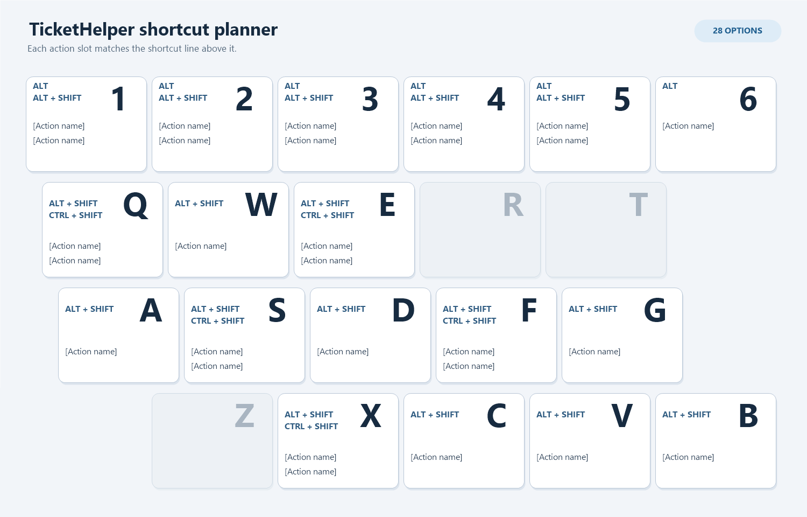

# Shortcut Planning (Chrome on Windows)

The keyboard image reserves three fixed modifier lines and three corresponding action lines per key. `[Action name]` is a placeholder, not a suggested or assigned command; unavailable combinations leave both matching lines blank. Keys with no available combination are dimmed.

This is the owner's planning table for possible Chrome extension command shortcuts. It does not assign keys in `project/manifest.json` or in Chrome. Existing user-assigned shortcuts remain untouched. `—` in **Suggested Action** means undecided; **Not use** marks a combination the owner has excluded from consideration. Other Chrome versions, websites, Windows utilities, and installed extensions can also claim keys, so verify a chosen shortcut in `chrome://extensions/shortcuts` on the target setup.

Chrome action descriptions below are based on [Chrome's Windows shortcut list](https://support.google.com/chrome/answer/157179?hl=en), [Chromium's accelerator mappings](https://chromium.googlesource.com/chromium/src.git/+/refs/heads/main/chrome/browser/ui/accelerator_table.cc), and [DevTools shortcuts](https://developer.chrome.com/docs/devtools/shortcuts). Tab-group commands may have no visible effect when their context is absent. The owner may use some combinations that Chrome also maps; only the struck-through combinations below are currently excluded by owner choice.

## Alt

| Key | Chrome action | Suggested Action |
| --- | --- | --- |
| 1 | None identified on Windows | — |
| 2 | None identified on Windows | — |
| 3 | None identified on Windows | — |
| 4 | None identified on Windows | — |
| 5 | None identified on Windows | — |
| 6 | None identified on Windows | — |

## Alt + Shift

| Key | Chrome action | Suggested Action |
| --- | --- | --- |
| 1 | None identified | — |
| 2 | None identified | — |
| 3 | None identified | — |
| 4 | None identified | — |
| 5 | None identified | — |
| Q | None identified | — |
| W | Close tab group, where supported | — |
| E | None identified | — |
| ~~R~~ | ~~Reading mode~~ | Not use |
| ~~T~~ | ~~Focus toolbar~~ | Not use |
| A | Focus inactive dialog | — |
| S | None identified | — |
| D | None identified | — |
| F | None identified | — |
| G | None identified | — |
| ~~Z~~ | ~~Previous tab group, where supported~~ | Not use |
| X | Next tab group, where supported | — |
| C | Add tab to group, where supported | — |
| V | None identified | — |
| B | Focus bookmarks bar | — |

## Ctrl + Shift

| Key | Chrome action | Suggested Action |
| --- | --- | --- |
| Q | None identified on Windows | — |
| ~~W~~ | ~~Close window~~ | Not use |
| E | None identified | — |
| ~~R~~ | ~~Hard reload~~ | Not use |
| ~~A~~ | ~~Tab search~~ | Not use |
| S | None identified | — |
| ~~D~~ | ~~Bookmark all tabs~~ | Not use |
| F | Search in DevTools when focused | — |
| ~~Z~~ | ~~Redo in many text editors~~ | Not use |
| X | None identified | — |
| ~~C~~ | ~~Inspect element~~ | Not use |
| ~~V~~ | ~~Paste without formatting~~ | Not use |
